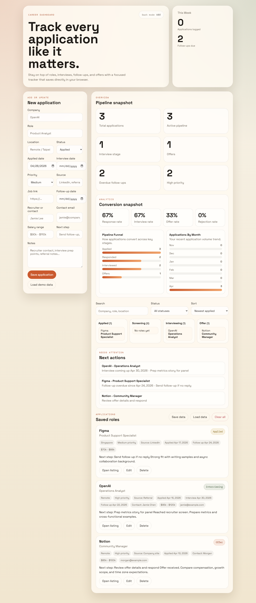
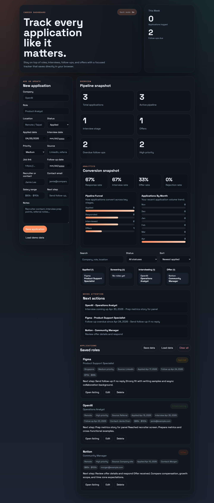

# Job Application Tracker

A browser-based tracker for managing job applications, interview stages, follow-up dates, and offers.

## Screenshots





## Features

- Add, edit, and delete applications
- Track company, role, status, salary, interview date, follow-up date, source, recruiter details, next step, link, and notes
- Filter by status, search by text, and sort by date, priority, follow-up timing, or company
- View summary metrics, response/interview/offer analytics, a lightweight pipeline board, and a next-actions panel
- Toggle between light and dark mode with saved preference
- Save data in the browser with `localStorage`
- Save your applications as JSON and load them back later
- Clear all saved application data intentionally
- Run a scripted browser verification against the real page

## Tech Stack

- HTML
- CSS
- Vanilla JavaScript
- Node.js for local preview and verification
- Playwright for browser automation

## Project Structure

```
.
|- index.html
|- styles.css
|- app.js
|- server.js
|- verify.mjs
|- package.json
|- README.md
|- .gitignore
```

## Run Locally

1. Run `npm install`
2. Run `npm run serve`
3. Open `http://127.0.0.1:4173`
4. Optional: run `npm run screenshots` to refresh the README preview images

## Verify In A Browser

Run `npm run verify`

This starts a local server, opens the tracker in Chromium through Playwright, and verifies the add, edit, and filter flows automatically.

## Data Notes

- Data is stored in the browser where the app is opened.
- The `Load demo data` button inserts sample entries for quick preview.
